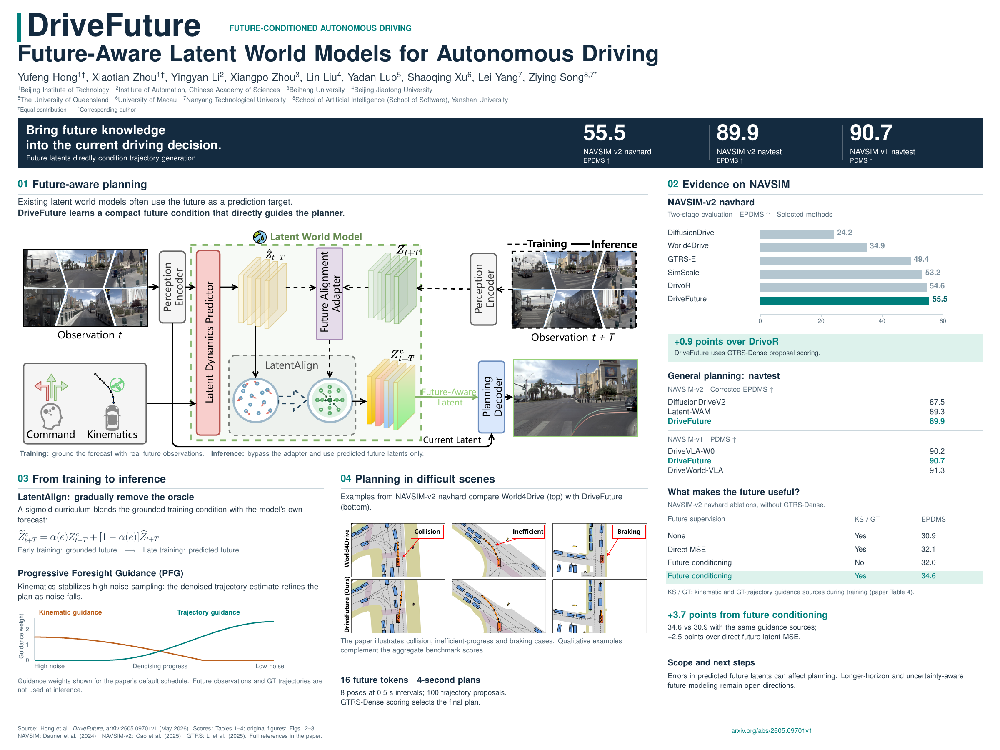

<div align="center">

# DriveFuture

**DriveFuture: Future-Aware Latent World Models for Autonomous Driving**

Yufeng Hong<sup>1†</sup>, Xiaotian Zhou<sup>1†</sup>, Yingyan Li<sup>2</sup>, Xiangpo Zhou<sup>3</sup>, Lin Liu<sup>4</sup>,
Yadan Luo<sup>5</sup>, Shaoqing Xu<sup>6</sup>, Lei Yang<sup>7</sup>, Ziying Song<sup>8,7*</sup>

<sup>1</sup> Beijing Institute of Technology &nbsp;
<sup>2</sup> Institute of Automation, Chinese Academy of Sciences &nbsp;
<sup>3</sup> Beihang University &nbsp;
<sup>4</sup> Beijing Jiaotong University<br>
<sup>5</sup> The University of Queensland &nbsp;
<sup>6</sup> University of Macau &nbsp;
<sup>7</sup> Nanyang Technological University &nbsp;
<sup>8</sup> School of Artificial Intelligence (School of Software), Yanshan University

<sup>†</sup> Equal contribution &nbsp;|&nbsp; <sup>*</sup> Corresponding author

[](https://arxiv.org/abs/2605.09701)
[](https://arxiv.org/pdf/2605.09701)

<br>



</div>

## News

* **` May 10th, 2026`:** We released our paper on [Arxiv](https://arxiv.org/abs/2605.09701)!
* **` TBD`:** Code and checkpoints will be released soon.

## Links

- [Introduction](#introduction)
- [Getting Started](#getting-started)
- [Model Zoo on NavSimV2](#model-zoo)
- [Acknowledgement](#acknowledgement)
- [Citation](#citation)

## Introduction

Existing latent world models for autonomous driving often treat the future as a prediction target, rather than as a condition that can directly improve the current plan. **DriveFuture** learns a compact future condition that guides trajectory generation: during training, the forecast is grounded with real future observations; at inference, the adapter is bypassed and only predicted future latents are used.

To bridge the train–test gap, **LatentAlign** gradually removes the oracle future via a sigmoid curriculum that blends grounded and predicted future conditions. **Progressive Foresight Guidance (PFG)** further stabilizes sampling: kinematic guidance is stronger at high noise, while trajectory guidance refines the plan as noise decreases. At inference, future observations and ground-truth trajectories are **not** used.

Extensive evaluations on NAVSIM validate DriveFuture. Notably, on NAVSIM-v2 **navhard**, DriveFuture achieves an **EPDMS of 55.5** (with GTRS-Dense scoring); on NAVSIM-v2 **navtest**, **89.9** corrected EPDMS; and on NAVSIM-v1 **navtest**, **90.7** PDMS.

ing started from NAVSIM environment preparation]
## Acknowledgement

DriveFuture is greatly inspired by the following outstanding contributions to the open-source community: [NAVSIM](https://github.com/autonomousvision/navsim), [GTRS](https://github.com/NVlabs/GTRS), [DiffusionDrive](https://github.com/hustvl/DiffusionDrive).

## Citation

If you find DriveFuture useful in your research or applications, please consider giving us a star 🌟 and citing it by the following BibTeX entry.

```bibtex
@misc{hong2026drivefuture,
      title={DriveFuture: Future-Aware Latent World Models for Autonomous Driving},
      author={Yufeng Hong and Xiaotian Zhou and Yingyan Li and Xiangpo Zhou and Lin Liu and Yadan Luo and Shaoqing Xu and Lei Yang and Ziying Song},
      year={2026},
      eprint={2605.09701},
      archivePrefix={arXiv},
      primaryClass={cs.CV},
      url={https://arxiv.org/abs/2605.09701},
}
```
